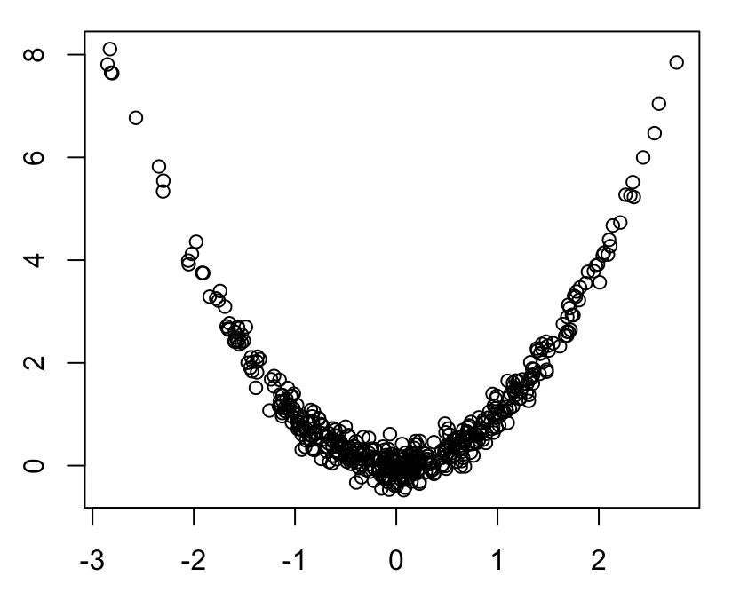
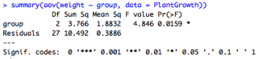
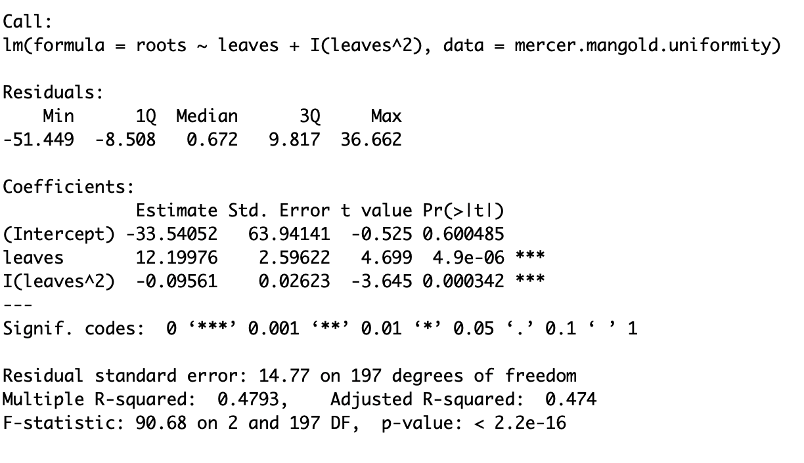
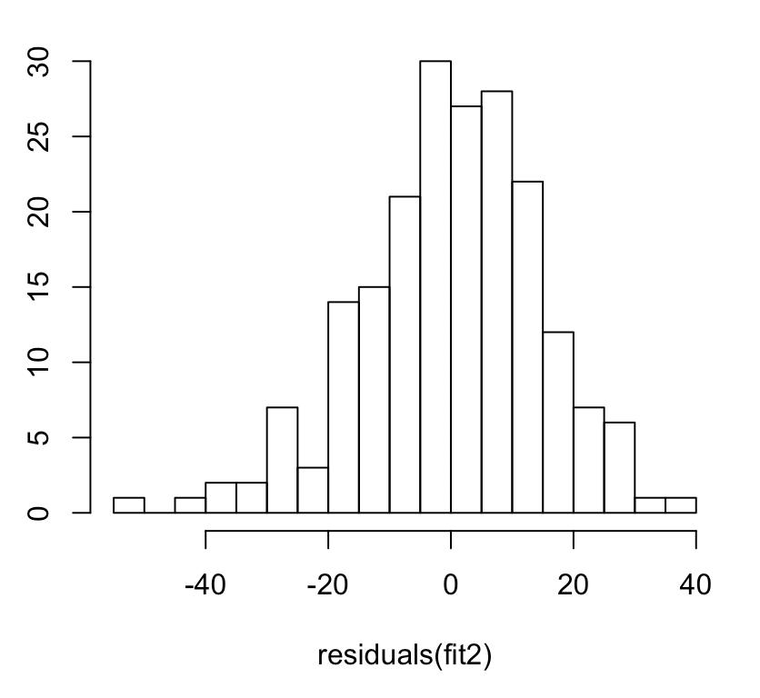

## Tipps zur Vorbereitung

**Was ist klausurrelevant?** Alles, was in der Vorlesung behandelt wurde. Die Vorlesungsfolien sind deshalb die wichtigste Grundlage. Das Skript ist eine sinnvolle Ergänzung, klausurrelevant ist aber nur, was in der Vorlesung vorkam. Teile, die in der Vorlesung ausdrücklich als Ausblick („nicht klausurrelevant“) gekennzeichnet sind, werden nicht geprüft.

**Was sollten Sie können?**

-   die grundlegenden Konzepte der Statistik verstehen und in eigenen Worten erklären,
-   die wichtigsten statistischen Methoden und ihren Anwendungsbereich kennen,
-   die Ergebnisse dieser Methoden interpretieren und kritisch beurteilen, z.B. einen Testoutput oder eine Regressionstabelle aus R.

Die Methoden selbst in R anzuwenden üben Sie in den Übungen. Das hilft indirekt auch für die Klausur, z.B. beim Lesen von R-Ausgaben.

**Wie bereiten Sie sich am besten vor?**

1.  Alle Vorlesungsfolien durcharbeiten. Die [Übersicht der Vorlesungsthemen](../index.qmd#vorlesungsthemen) auf der Startseite hilft bei der Orientierung.
2.  Die elektronischen Übungen noch einmal durchgehen. Sie sind typisch für Fragen, die in der Klausur vorkommen können, und werden zur Vorbereitung wieder freigeschaltet.
3.  Die Testfragen aus der Zusammenfassungsvorlesung (VII.2) und die Fragensammlung unten durcharbeiten.
4.  Ergänzend: das Skript, den [R-Code der Vorlesung](../vorlesung/R-Code-Vorlesung.qmd), den Stoff der Tutorate und die Literaturempfehlungen. Oft hilft es, den gleichen Stoff noch einmal aus einem anderen Blickwinkel erklärt zu bekommen.
5.  Offene Fragen in die Fragestunde des Tutors in der Woche vor der Klausur mitbringen (Termin über GRIPS).

Termin und Format der Klausur werden über GRIPS bzw. SPUR bekannt gegeben.

## Übungsfragen

Die folgende Fragensammlung soll helfen, das eigene Wissen zu testen und mögliche Lücken zu entdecken.

**[Wichtig:]{.underline}** Diese Fragensammlung ist keinesfalls ein vollständiger Katalog der Fragen oder Themen, die in der Klausur vorkommen können. Grundsätzlich sind **[alle Themen der Vorlesung klausurrelevant]{.underline}**. Teilen Sie Ihre Lernprioritäten also nicht anhand dieses Fragenkatalogs ein.

Die Antworten sind eingeklappt: erst selbst überlegen, dann aufklappen. Am Ende jeder Antwort steht, in welcher Vorlesung Sie das Thema nachlesen können (z.B. IV.1 = Woche 4, Dienstag; IV.2 = Woche 4, Donnerstag). Welche Themen in welcher Vorlesung behandelt wurden, steht in der [Übersicht der Vorlesungsthemen](../index.qmd#vorlesungsthemen) auf der Startseite.

## Deskriptive Statistik und Daten

**Frage 1.** Was ist der Unterschied zwischen deskriptiver und schließender Statistik?

::: {.callout-note collapse="true" title="Antwort"}
Deskriptive Statistik ist eine reine Zusammenfassung der Daten. Schließende Statistik benutzt Wahrscheinlichkeitsaussagen (wie wahrscheinlich wäre es, diese Daten zu sehen, wenn kein Effekt da ist) um Schlüsse aus den Daten zu ziehen.

Nachlesen können Sie das in der Vorlesung I.1.
:::

**Frage 2.** Berechnen Sie Mittelwert, Standardabweichung, Standardfehler und Schiefe für die folgenden Daten: -1, 0, 1

::: {.callout-note collapse="true" title="Antwort"}
Mittelwert: 1/3 \* (-1 + 0 + 1) = 0, sd = sqrt(1/3 \* (-1\^2 + 0\^2 + 1\^2) ) = sqrt(2/3), SE = sqrt(2/3) / sqrt(3) = sqrt(2/9), Schiefe = 1/3 \* (-1\^3 + 0\^3 + 1\^3) = 0

Nachlesen können Sie das in den Vorlesungen I.1 und IV.1.
:::

**Frage 3.** Was ist der Unterschied zwischen der normalen und der korrigierten Stichprobenvarianz?

::: {.callout-note collapse="true" title="Antwort"}
Wenn wir die Formel für die Varianz auf eine kleine Stichprobe anwenden, so ist der Wert typischerweise zu klein. Die Formel für die Varianz ist [kein guter Schätzer]{.underline} für die wahre Varianz der Verteilung. Die korrigierte Stichprobenvarianz teilt statt 1/N mit 1/(N-1) und ist für kleine N (Stichprobengröße) ein besserer Schätzer für die zu Grunde liegende wahre Varianz der Verteilung, aus der die Stichprobe gezogen wurde

Nachlesen können Sie das in der Vorlesung I.1.
:::

**Frage 4.** Wenn der Mittelwert wesentlich größer ist als der Median, was lässt sich dann über die Schiefe der Verteilung vermuten?

::: {.callout-note collapse="true" title="Antwort"}
Schiefe \> 0 = rechtsschief. Tipp: lesen Sie noch mal die Artikel über Schiefe, Mittelwert usw. auf Wikipedia, siehe, z.B. https://de.wikipedia.org/wiki/Schiefe\_(Statistik)

Nachlesen können Sie das in der Vorlesung I.1.
:::

**Frage 5.** Ist die Pearson Korrelation der folgenden Daten negativ, positiv, oder Null?

{width=60%}

::: {.callout-note collapse="true" title="Antwort"}
Null

Nachlesen können Sie das in der Vorlesung II.1.
:::

**Frage 6.** Würde sich bei Anwendung eines Rangkorrelationskoeffizienten (z.B. Spearman) eine andere Antwort ergeben?

::: {.callout-note collapse="true" title="Antwort"}
Nein, der wäre auch Null weil die Beziehung symmetrisch ist. Schauen Sie sich in der Vorlesung noch mal die Erklärung über die 4 Quadranten an.

Nachlesen können Sie das in der Vorlesung II.1.
:::

**Frage 7.** In welchen Situationen erwarten Sie größere Unterschiede zwischen der linearen Korrelation (Pearson) und Rangkorrelationskoeffizienten?

::: {.callout-note collapse="true" title="Antwort"}
Bei nichtlinearen Korrelationen und wenn es Ausreißer (extreme Werte) in den Daten gibt.

Nachlesen können Sie das in der Vorlesung II.1.
:::

**Frage 8.** Was ist der Unterschied zwischen Korrelation und Assoziation?

::: {.callout-note collapse="true" title="Antwort"}
Ist wenigstens eine der beiden Variablen nominal (ungeordnet), spricht man von Assoziation, ansonsten von Korrelation (ordinale Variablen sind ein Grenzfall, siehe Vorlesung II.1)

Nachlesen können Sie das in der Vorlesung II.1.
:::

**Frage 9.** Welche anderen Skalenniveaus gibt es noch, außer metrisch? (Geben Sie min. 2 Skalenniveaus an)

::: {.callout-note collapse="true" title="Antwort"}
nominal (ungeordnet), ordinal (geordnet)

Nachlesen können Sie das in der Vorlesung I.1.
:::

**Frage 10.** Geben Sie ein Beispiel für eine ordinale Variable

::: {.callout-note collapse="true" title="Antwort"}
Eine Variable mit den Werten: winzig, mittel, groß

Nachlesen können Sie das in der Vorlesung I.1.
:::

**Frage 11.** Beschriften Sie alle Elemente eines Boxplots mit den dazugehörigen statistischen Maßzahlen

::: {.callout-note collapse="true" title="Antwort"}
Siehe Vorlesung -- wichtig ist, dass Sie [alle]{.underline} Elemente des Boxplots verstehen und erklären können

Nachlesen können Sie das in den Vorlesungen I.1 und II.1.
:::

**Frage 12.** Warum wird beim Boxplot die Mitte der Verteilung durch den Median und nicht dem Mittelwert angegeben? Durch welche Eigenschaften unterscheiden sich diese beiden Größen?

::: {.callout-note collapse="true" title="Antwort"}
Weil der Median bei schiefen Verteilungen weniger stark durch extreme Werte beeinflusst wird, und so typischerweise ein besseres Maß für den „mittleren" Wert ist.

Nachlesen können Sie das in der Vorlesung I.1.
:::

**Frage 13.** Kann man aus der Höhe der Box auf die Unsicherheit des Mittelwertes schließen? Ist der Mittelwert oder Median einer größeren (weiteren) Box wahrscheinlich unsicherer als der Mittelwert einer kleineren Box? Begründen Sie die Antwort über die Definition des Standardfehlers.

::: {.callout-note collapse="true" title="Antwort"}
Der Standardfehler ist $sd/\sqrt{n}$ . Die Box zeigt den Interquartilsabstand, der sicher mit der Standardabweichung zusammenhängt, aber was fehlt ist die Information über die Stichprobengröße n. Man würde der Aussage also nur zustimmen, wenn man weiß, dass beiden Boxen das gleiche n zu Grunde liegt.

Nachlesen können Sie das in den Vorlesungen I.1 und IV.1.
:::

**Frage 14.** Erklären Sie die Idee hinter der PCA

::: {.callout-note collapse="true" title="Antwort"}
Siehe Vorlesung

Nachlesen können Sie das in der Vorlesung II.2.
:::

**Frage 15.** Was ist das Ziel eines Clusterverfahrens?

::: {.callout-note collapse="true" title="Antwort"}
Gruppen von ähnlichen Datenpunkten zu bilden

Nachlesen können Sie das in der Vorlesung II.2.
:::

**Frage 16.** Was versteht man unter einer Scheinkorrelation?

::: {.callout-note collapse="true" title="Antwort"}
Eine Korrelation, der kein kausaler Zusammenhang zu Grunde liegt.

Nachlesen können Sie das in den Vorlesungen II.1 und V.1.
:::

## Hypothesentests

**Frage 17.** Erklären Sie die Funktionsweise eines Nullhypothesentests.

::: {.callout-note collapse="true" title="Antwort"}
Siehe Vorlesung. Sie sollten sich diesen Punkt genau anschauen!

Nachlesen können Sie das in der Vorlesung III.1.
:::

**Frage 18.** Was ist die Idee hinter der „Teststatistik" und deren Verteilung in einem Hypothesentest?

::: {.callout-note collapse="true" title="Antwort"}
Die Teststatistik ist eine deskriptive Statistik, die die beobachteten Daten beschreibt. Der Wert der Teststatistik wird in einem Hypothesentest mit den erwarteten Werten der Teststatistik unter der Nullhypothese verglichen, woraus sich dann der p-Wert ergibt. Details siehe Vorlesung

Nachlesen können Sie das in der Vorlesung III.1.
:::

**Frage 19.** Wie wählt man die Nullhypothese in einem Hypothesentest?

::: {.callout-note collapse="true" title="Antwort"}
Als Nullhypothese setzt man eine Annahme, von der man zeigen will, dass sie nicht mit den Daten kompatibel ist. Die typische Nullhypothese in der Biologie ist, dass eine Behandlung oder ein Faktor keinen Effekt hat. Wenn man dann zeigen kann, dass diese Annahme nicht mit den Daten kompatibel ist, so hat man einen Effekt nachgewiesen.

Nachlesen können Sie das in der Vorlesung III.1.
:::

**Frage 20.** Warum erhält man bei Signifikanztests (basierend auf dem p-Wert) mit einem Signifikanzniveau von 0.05 genau 5 % falsche Positive?

::: {.callout-note collapse="true" title="Antwort"}
Der p-Wert ist die Wahrscheinlichkeit, einen gegebenen Wert (definiert durch die Teststatistik) oder extremer zu erhalten, wenn H0 wahr ist - diese Definition impliziert, dass die Wahrscheinlichkeit einen p-Wert unter 5% zu bekommen 5% ist, wenn H0 wahr ist (wenn Ihnen das nicht einleuchtet, schauen sie nochmal auf die visuelle Erklärung des p-Wertes aus der Vorlesung).

Nachlesen können Sie das in der Vorlesung III.1.
:::

**Frage 21.** Was ist der Unterschied zwischen Typ I Fehler und der \"False Discovery Rate\"?

::: {.callout-note collapse="true" title="Antwort"}
Typ I Fehlerrate = wie häufig treten falsche positiv signifikante Ergebnisse auf, wenn H0 wahr ist. FDR = wie groß ist der Anteil falscher positiver unter allen signifikanten Ergebnissen. Während die Typ I Fehlerrate fix und gleich des Signifikanzniveaus ist, hängt die FDR von sowohl von der Power als auch von der a priori Wahrscheinlichkeit der Nullhypothese ab.

Nachlesen können Sie das in der Vorlesung III.2.
:::

**Frage 22.** Berechnen Sie die "False Discovery Rate" für: Signifikanzlevel = 0.05, Power = 0.4, p(H0) = 0.5

::: {.callout-note collapse="true" title="Antwort"}
0.05 \* 0.5 / (0.05 \* 0.5 + 0.4 \* 0.5) -\> Rate Typ I / (Rate Typ I + Rate echte Positive)

Nachlesen können Sie das in der Vorlesung III.2.
:::

**Frage 23.** Der p-Wert eines Experiments ist 0.04 - ist die folgende Aussage richtig? "Die Wahrscheinlichkeit, dass H0 wahr ist, ist 4%." Begründen Sie Ihre Antwort.

::: {.callout-note collapse="true" title="Antwort"}
Nein. Begründung: Der p-Wert gibt die Wahrscheinlichkeit der Daten gegeben H0 an - wie wahrscheinlich es ist, dass H0 oder nicht H0 zutrifft, kann man daraus nicht sehen. Wenn überhaupt, müsste man für eine solche Aussage die FDR berechnen.

Nachlesen können Sie das in den Vorlesungen III.2 und IV.1.
:::

**Frage 24.** Eine ANOVA liefert das nachfolgende Ergebnis. „weight" bezeichnet hierbei das Pflanzengewicht, und „group" ist die erklärende Variable (3 Gruppen). Die Frage an Sie: i) Welche Nullhypothese testet eine ANOVA ii) Ist das Ergebnis signifikant? iii) Wird die Nullhypothese abgelehnt? iv) wie würden Sie das Resultat in einer wissenschaftlichen Arbeit in einem Satz zusammenfassen?

{width=60%}

::: {.callout-note collapse="true" title="Antwort"}
i\) H0: Die Mittelwerte aller Gruppen sind gleich ii) ja iii) ja iv) Die Mittelwerte der Gruppen unterscheiden sich signifikant (ANOVA, p \< 0.05)

Nachlesen können Sie das in der Vorlesung IV.2.
:::

## Likelihood und lineare Regression

**Frage 25.** Wie funktioniert die Methode des Maximum Likelihood Schätzers in Worten?

::: {.callout-note collapse="true" title="Antwort"}
Man stellt ein Modell für die Wahrscheinlichkeit der Daten gegeben die Parameter auf (Likelihood). Dann sucht man die Parameter, für die diese Wahrscheinlichkeit der Daten maximal ist.

Nachlesen können Sie das in der Vorlesung IV.1.
:::

Die folgenden Fragen beziehen sich auf das nachfolgende Regressionsergebnis:

{width=70%}

**Frage 26.** Welche Art von Kurve wird hier gefittet?

::: {.callout-note collapse="true" title="Antwort"}
Eine der folgenden Antworten wäre ausreichend: Polynom 2. Ordnung, quadratisches Polynom, y = a0 + a1\*x + a2 \* x\^2

Nachlesen können Sie das in der Vorlesung IV.1.
:::

**Frage 27.** Was ist der beste Schätzer (MLE) für den hier gefitteten Zusammenhang? Schreiben Sie diesen als Funktionsgleichung auf.

::: {.callout-note collapse="true" title="Antwort"}
roots = -33.54052 + 12.19976 \* leaves + -0.09561 \* leaves\^2

Nachlesen können Sie das in den Vorlesungen IV.1 und IV.2.
:::

**Frage 28.** Der p-Wert für den Achsenabschnitt (Intercept) ist nicht signifikant. Was testet eigentlich dieser Wert, d.h. was ist die Nullhypothese und wie würde man das Ergebnis interpretieren?

::: {.callout-note collapse="true" title="Antwort"}
H0: Der Wert des Achsenabschnitts (Intercept) ist 0. Die Interpretation des Achsenabschnitts ist der erwartete Wert der abhängigen Variable wenn alle erklärenden Variablen einen Wert von Null annehmen. In der Praxis ist dieser Wert meist weniger von Interesse als die Effektschätzer (= die Schätzer für den Effekt der erklärenden Variablen).

Nachlesen können Sie das in der Vorlesung IV.2.
:::

**Frage 29.** Schauen Sie auf die Kennzahlen für die Verteilung der Residuen - ist die Verteilung stark asymmetrisch (konzentrieren Sie sich dabei auf Q1, Median und Q3 - min/max sind zu stark von einzelnen Werten beeinflusst)?

::: {.callout-note collapse="true" title="Antwort"}
Nein, nicht stark asymmetrisch, fast gleiche Abstände zwischen Q1, Median, Q3

Nachlesen können Sie das in der Vorlesung IV.2.
:::

**Frage 30.** Was sind denn eigentlich diese \"Residuen\", d.h. wie werden die Residuen berechnet?

::: {.callout-note collapse="true" title="Antwort"}
Residuen = Differenzen (mit Vorzeichen) zwischen den Daten und der Modellvorhersage (Polynom, siehe Frage oben), d.h. es gibt ein Residuum pro Datenpunkt.

Nachlesen können Sie das in der Vorlesung IV.1.
:::

**Frage 31.** Wie sollten die Residuen bei der linearen Regression verteilt sein? Sieht die folgende Verteilung gut aus?

{width=60%}

::: {.callout-note collapse="true" title="Antwort"}
Sie sollten normalverteilt sein. Die Verteilung sieht grob wie eine Normalverteilung aus (kleine Linksschiefe, aber ein paar Schwankungen sind natürlich immer da)

Nachlesen können Sie das in der Vorlesung IV.2.
:::

**Frage 32.** Was ist der Unterschied zwischen einer einfachen und einer multiplen linearen Regression?

::: {.callout-note collapse="true" title="Antwort"}
In einer multiplen Regression analysiert man den Effekt von mehreren erklärenden Variablen auf die abhängige Variable

Nachlesen können Sie das in der Vorlesung V.1.
:::

**Frage 33.** Was ist der Unterschied in der Interpretation eines Effektschätzers in einer multiplen Regression, im Vergleich zur einfachen Regression?

::: {.callout-note collapse="true" title="Antwort"}
Eine multiple Regression schätzt die Effekte der erklärenden Variablen [korrigiert]{.underline} für den Effekt der jeweils anderen Variablen. Die Effektschätzer sind deshalb im Allgemeinen unterschiedlich zur einfachen Regression. Die Unterschiede sind stärker je stärker die Korrelation der erklärenden Variable untereinander ist (= Kollinearität). Ob die Schätzer aus der einfachen oder der multiplen Regression wissenschaftlich sinnvoller sind, ergibt sich aus einer Analyse der kausalen Beziehungen zwischen den Variablen (siehe Vorlesung zur Kausalität).

Nachlesen können Sie das in der Vorlesung V.1.
:::

## GLM und Modellvergleich

**Frage 34.** Wie unterscheidet sich ein GLM von einem LM?

::: {.callout-note collapse="true" title="Antwort"}
Link-Funktion und Verteilung

Nachlesen können Sie das in der Vorlesung VI.1.
:::

**Frage 35.** Was ist der Sinn der Link-Funktion in einem GLM?

::: {.callout-note collapse="true" title="Antwort"}
Die Vorhersagen auf einen bestimmten Wertebereich (z.B. positiv) zu begrenzen

Nachlesen können Sie das in der Vorlesung VI.1.
:::

**Frage 36.** Warum gibt es bei GLMs Overdispersion, bei LMs aber nicht?

::: {.callout-note collapse="true" title="Antwort"}
Weil die Normalverteilung einen Parameter für die Varianz hat, aber viele GLM-Verteilungen (z.B. Poisson, Binomial) nicht

Nachlesen können Sie das in der Vorlesung VI.1.
:::

**Frage 37.** Nennen Sie zwei Methoden, um Modelle zu vergleichen.

::: {.callout-note collapse="true" title="Antwort"}
AIC und Likelihood-Ratio Tests

Nachlesen können Sie das in der Vorlesung V.2.
:::

## Maschinelles Lernen

**Frage 38.** Wodurch unterscheiden sich statistische Modelle und Algorithmen des maschinellen Lernens?

::: {.callout-note collapse="true" title="Antwort"}
ML-Algorithmen haben typischerweise keine Annahmen eines datengenerierenden Modells und deshalb auch keine Likelihood, p-Werte etc. Ihre Parameter werden nach allgemeinen Zielfunktionen, welche die erreichte Vorhersagegüte quantifizieren optimiert.

Nachlesen können Sie das in der Vorlesung VI.2.
:::

**Frage 39.** Erklären Sie die wesentlichen Elemente eines neuronalen Netzwerkes

::: {.callout-note collapse="true" title="Antwort"}
Siehe Vorlesung -- ein neuronales Netzwerk besteht aus Neuronen, die durch gewichtete Links verbunden sind. Die Eingangsneuronen eines neuronalen Netzwerkes sind unsere erklärenden Variablen. Die inneren Neuronen summieren die eingehenden gewichteten Werte der vorherigen Neuronen auf, mit denen sie verbunden sind und werden dann ab einem bestimmten Wert (Aktivierungsfunktion!) selbst aktiviert. Die Verbindungen (Gewichte) zwischen den Neuronen werden solange geändert (trainiert) bis das Netzwerk die gewünschte Input-Output Beziehung darstellt.

Nachlesen können Sie das in der Vorlesung VI.2.
:::

**Frage 40.** Erklären Sie den Trade-off zwischen Bias und Varianz

::: {.callout-note collapse="true" title="Antwort"}
Bei der Erhöhung der Modellkomplexität verringert sich der systematische Fehler des Modells (=Bias) weil das Modell flexibler ist, aber es erhöht sich gleichzeitig der statistische Fehler auf den Schätzern der Modellparameter (= Varianz). Aus dieser Beziehung ergibt sich, dass typischerweise Modelle mit einer mittleren Komplexität den geringsten Gesamtfehler haben.

Nachlesen können Sie das in den Vorlesungen V.2 und VI.2.
:::

**Frage 41.** Erklären Sie, warum man im maschinellen Lernen (aber auch in der Statistik) Daten oft in Trainings und Validierungsdaten aufteilt

::: {.callout-note collapse="true" title="Antwort"}
Im Training sind komplexere Modelle immer besser, da sie sich immer besser an die bestehenden Daten anpassen können. Deshalb testet man Modelle an Daten, die nicht für das Training bzw. den Fit der Parameter benutzt wurden.

Nachlesen können Sie das in der Vorlesung VI.2.
:::

## Kausalität und Validität

**Frage 42.** Erklären Sie die 3 grundlegenden kausalen Beziehungen, die im Zusammenspiel mit einer primären Korrelation (y \~ x) und einer zusätzlichen Variable z entstehen können.

::: {.callout-note collapse="true" title="Antwort"}
Confounder (Störfaktoren), Mediator, Collider. Details siehe Vorlesung

Nachlesen können Sie das in der Vorlesung V.1.
:::

**Frage 43.** Warum sollten Sie skeptisch sein, wenn Sie in einer Studie lesen, dass das Tragen von teurem Goldschmuck die Gesundheit fördert? (Die Studie untersuchte 5000 zufällig ausgewählte Personen aus der deutschen Bevölkerung. In einer einfachen Regression zeigte sich, dass das Tragen von Goldschmuck ein signifikanter Prädiktor für die Lebenserwartung ist.)

::: {.callout-note collapse="true" title="Antwort"}
Weil offensichtliche Störfaktoren nicht bedacht wurden (welche klären wir mit der nächsten Frage)

Nachlesen können Sie das in der Vorlesung V.1.
:::

**Frage 44.** Nennen Sie mindestens 2 offensichtliche Störfaktoren, um einen Zusammenhang zwischen Goldschmuck und Lebenserwartung in einer zufällig ausgewählten Stichprobe von Personen nachzuweisen. Geben Sie jeweils eine Erklärung, warum diese Faktoren Störfaktoren sind (Korrelation mit erkl. und abh. Variable).

::: {.callout-note collapse="true" title="Antwort"}
Geschlecht (Frauen leben länger und Frauen tragen mehr Schmuck), Vermögen (vermögende Personen haben mehr Goldschmuck, und typischerweise auch bessere Gesundheit)

Nachlesen können Sie das in der Vorlesung V.1.
:::

**Frage 45.** Welcher Typ von Validität war in dieser Studie nicht gegeben?

::: {.callout-note collapse="true" title="Antwort"}
Interne Validität

Nachlesen können Sie das in der Vorlesung VII.1.
:::

**Frage 46.** Erklären Sie am Beispiel der oben genannten Studie das Konzept der externen Validität.

::: {.callout-note collapse="true" title="Antwort"}
externe Validität = kann man die Studienergebnisse verallgemeinern? Externe Validität würde, z.B., die Frage bezeichnen, ob man die Ergebnisse der gegebenen Stichprobe auf die deutsche Bevölkerung oder Menschen im Allgemeinen (ganze Welt) verallgemeinern kann.

Nachlesen können Sie das in der Vorlesung VII.1.
:::

## Versuchsplanung

**Frage 47.** Wenn man wissen will, wie viele Beobachtungen (Replikate) man für ein Experiment braucht, macht man …

::: {.callout-note collapse="true" title="Antwort"}
Eine Poweranalyse

Nachlesen können Sie das in den Vorlesungen III.1 und VII.1.
:::

## Maschinelles Lernen: Ergänzung

**Frage 48.** Was versteht man unter Overfitting und Underfitting, und woran erkennt man sie?

::: {.callout-note collapse="true" title="Antwort"}
Underfitting: Das Modell ist zu einfach und hat einen großen systematischen Fehler (Bias); es passt schlecht zu Trainings- und Testdaten. Overfitting: Das Modell ist zu flexibel und passt sich dem Rauschen an (Varianz); der Trainingsfehler ist klein, der Fehler auf neuen Daten groß. Erkennen kann man beides am Vergleich von Trainings- und Testfehler, z.B. per Kreuzvalidierung.

Nachlesen können Sie das in der Vorlesung VI.2.
:::

**Frage 49.** Erklären Sie die k-fache Kreuzvalidierung.

::: {.callout-note collapse="true" title="Antwort"}
Man teilt die Daten zufällig in k gleich große Gruppen (Folds). Das Modell wird k-mal auf k−1 Folds gefittet und sagt den jeweils ausgelassenen Fold vorher. Der mittlere Vorhersagefehler über alle Folds schätzt den Fehler auf neuen Daten; das Modell mit dem kleinsten Fehler generalisiert am besten.

Nachlesen können Sie das in der Vorlesung VI.2.
:::

**Frage 50.** Ein Random Forest zeigt für Variable X die höchste Variable Importance. Beeinflusst X die abhängige Variable also kausal?

::: {.callout-note collapse="true" title="Antwort"}
Nein. Variable Importance misst, wie nützlich X für die Vorhersage ist. X kann z.B. mit einem Störfaktor korreliert sein. Für eine kausale Aussage braucht man eine kausale Analyse oder ein Experiment.

Nachlesen können Sie das in der Vorlesung VI.2.
:::

**Frage 51.** Was ist Data Leakage, und warum ist es ein Problem?

::: {.callout-note collapse="true" title="Antwort"}
Informationen aus den Testdaten fließen ins Training, z.B. wenn man Variablen auf allen Daten auswählt oder Messungen desselben Individuums in Training und Test landen. Dann ist der geschätzte Vorhersagefehler zu optimistisch.

Nachlesen können Sie das in der Vorlesung VI.2.
:::

## Versuchsplanung: Ergänzung

**Frage 52.** Erklären Sie die drei Grundprinzipien eines kontrollierten Experiments: Kontrolle, Randomisierung, Replikation.

::: {.callout-note collapse="true" title="Antwort"}
Kontrolle: Es gibt eine Vergleichsgruppe ohne Behandlung, sonst gleiche Bedingungen. Randomisierung: Die Behandlungen werden zufällig zugewiesen, damit Störfaktoren nicht mit der Behandlung korrelieren. Replikation: Es gibt mehrere unabhängige Versuchseinheiten pro Behandlung, um die Variabilität zu schätzen.

Nachlesen können Sie das in der Vorlesung VII.1.
:::

**Frage 53.** Was unterscheidet ein vollständig randomisiertes Design von einem randomisierten Blockdesign? Nennen Sie ein biologisches Beispiel.

::: {.callout-note collapse="true" title="Antwort"}
Im Blockdesign fasst man ähnliche Versuchseinheiten zu Blöcken zusammen (z.B. Parzellen mit gleichem Boden). Innerhalb jedes Blocks wird jede Behandlung zufällig zugewiesen. Unterschiede zwischen den Blöcken stören dann den Vergleich nicht. Ausgewertet wird mit Block als Faktor. Beispiel: Düngerversuch auf einem Feld mit Bodengradient.

Nachlesen können Sie das in der Vorlesung VII.1.
:::

**Frage 54.** Sie messen je 10 Blätter einer gedüngten und einer ungedüngten Pflanze. Wie viele echte Replikate haben Sie pro Behandlung?

::: {.callout-note collapse="true" title="Antwort"}
Eines. Die Versuchseinheit ist die Pflanze; die 10 Blätter sind Pseudoreplikate, weil sie nicht unabhängig sind.

Nachlesen können Sie das in der Vorlesung VII.1.
:::

**Frage 55.** Was bedeutet „doppelblind“, und wovor schützt es?

::: {.callout-note collapse="true" title="Antwort"}
Weder Proband noch Behandelnder bzw. Beobachter wissen, ob Kontrolle oder Behandlung gegeben wird. Das schützt vor Verzerrung durch Erwartungen (Placebo-Effekt, Experimenter's bias).

Nachlesen können Sie das in der Vorlesung VII.1.
:::

**Frage 56.** Sie wollen prüfen, ob die Wirkung eines Pestizids von der Temperatur abhängt. Welche Behandlungen brauchen Sie?

::: {.callout-note collapse="true" title="Antwort"}
Ein faktorielles Design: beide Faktoren auf hoch und tief, in allen Kombinationen, also 2 × 2 = 4 Behandlungen. Auswertung mit Interaktion: y \~ Pestizid \* Temperatur.

Nachlesen können Sie das in der Vorlesung VII.1.
:::

**Frage 57.** Wann darf man einen einseitigen Test verwenden?

::: {.callout-note collapse="true" title="Antwort"}
Nur wenn die Richtung des Effekts vor der Datenerhebung festgelegt wurde. Erst nach dem Blick auf die Daten auf einseitig zu wechseln, ist p-Hacking.

Nachlesen können Sie das in den Vorlesungen III.2 und VII.1.
:::

## Weitere Fragen zu Tests, Modellen und Zufall

**Frage 58.** Was ist der Unterschied zwischen gepaartem und ungepaartem t-Test? Nennen Sie ein Beispiel.

::: {.callout-note collapse="true" title="Antwort"}
Beim gepaarten Test gehören die Messungen paarweise zusammen, z.B. Blutdruck derselben Person vor und nach der Behandlung. Getestet wird, ob die Differenzen im Mittel 0 sind.

Nachlesen können Sie das in der Vorlesung III.2.
:::

**Frage 59.** Wann nehmen Sie statt des t-Tests den Mann-Whitney-U-Test, und warum nicht immer?

::: {.callout-note collapse="true" title="Antwort"}
Wenn die Normalverteilungsannahme nicht plausibel ist. Nicht immer, weil der nichtparametrische Test bei normalverteilten Daten etwas weniger Power hat.

Nachlesen können Sie das in der Vorlesung III.2.
:::

**Frage 60.** Mit welchem Test prüfen Sie, ob zwei kategoriale Variablen assoziiert sind? Was ist H0?

::: {.callout-note collapse="true" title="Antwort"}
Pearsons Chi-Quadrat-Test (chisq.test). H0: Die Variablen sind nicht assoziiert (unabhängig).

Nachlesen können Sie das in der Vorlesung III.2.
:::

**Frage 61.** Nennen Sie je ein biologisches Beispiel für binomial- und für Poisson-verteilte Daten. Welches GLM verwenden Sie jeweils?

::: {.callout-note collapse="true" title="Antwort"}
Binomial: Überleben ja/nein oder k gekeimte von n Samen → logistische Regression. Poisson: Anzahl Keimlinge pro Probe → Poisson-Regression (log-Link).

Nachlesen können Sie das in den Vorlesungen I.2 und VI.1.
:::

**Frage 62.** Welche Information liefert ein Konfidenzintervall über den p-Wert hinaus?

::: {.callout-note collapse="true" title="Antwort"}
Die Größe des Effekts und ihre Unsicherheit, also einen Bereich plausibler Werte. Der p-Wert sagt nur, ob die Daten mit H0 vereinbar sind.

Nachlesen können Sie das in der Vorlesung IV.1.
:::

**Frage 63.** Was besagt der zentrale Grenzwertsatz, und warum ist er für die Statistik wichtig?

::: {.callout-note collapse="true" title="Antwort"}
Summen bzw. Mittelwerte vieler unabhängiger Zufallsgrößen sind annähernd normalverteilt. Deshalb ist die Normalverteilung so häufig, und viele Schätzer, z.B. der Mittelwert, sind annähernd normalverteilt.

Nachlesen können Sie das in den Vorlesungen I.2 und IV.1.
:::

**Frage 64.** Was ist der Vorteil eines kontrollierten Experiments gegenüber einer Beobachtungsstudie?

::: {.callout-note collapse="true" title="Antwort"}
Durch die Randomisierung sind Störfaktoren nicht mit der Behandlung korreliert. Ein Unterschied lässt sich deshalb kausal der Behandlung zuschreiben (interne Validität).

Nachlesen können Sie das in der Vorlesung VII.1.
:::

**Frage 65.** Was sagt R² aus, und warum darf man es nicht zur Modellauswahl benutzen?

::: {.callout-note collapse="true" title="Antwort"}
R² ist der Anteil der Varianz, den das Modell erklärt. Es steigt mit jeder zusätzlichen Variable, auch wenn sie nur Rauschen ist. Für die Modellwahl nimmt man deshalb z.B. den AIC.

Nachlesen können Sie das in den Vorlesungen IV.2 und V.2.
:::
